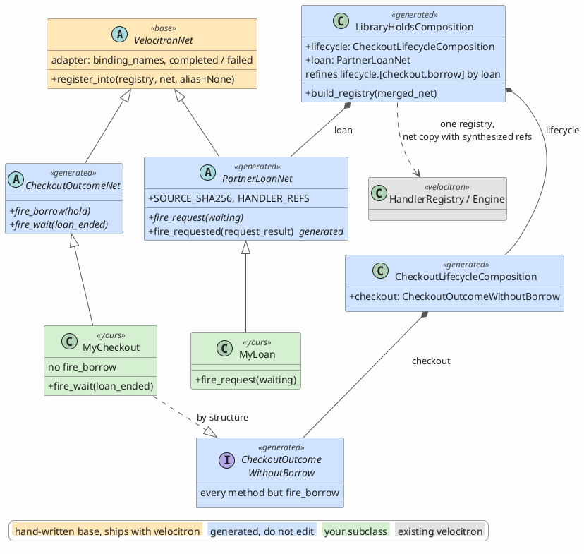
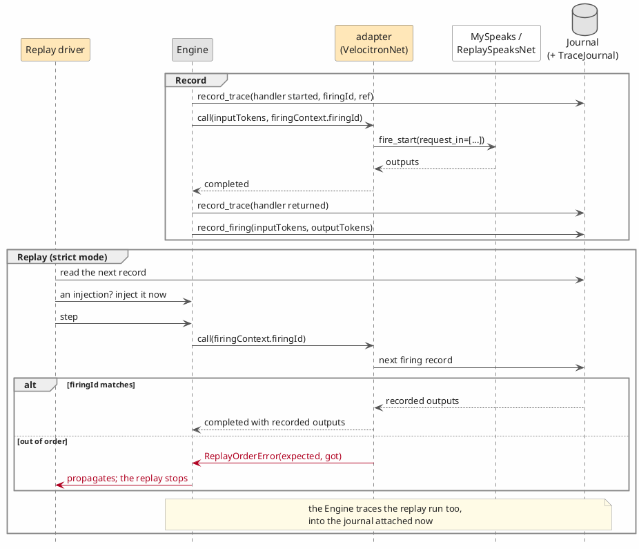

# A net compiles to a Python base class, and the journal traces and replays the run

**Status:** Accepted (2026-10-21). Builds on ADR 0003 (the handler
contract), ADR 0009 (`Engine.validate`), ADR 0022 (the sqlite journal and
tape replay), ADR 0023 (a host may synthesize handlers), ADR 0026 (generate,
then `--check`), ADR 0032 (`binding_names`), ADR 0034 and ADR 0041
(refinement and nested compositions). Code facts are read from the tree.

A `.petrinet` net names its code by opaque strings: `[start] handler
"start@speaks"`, `[start] guard "g"`, and `predicate handler "p"` on an arc.
The Engine resolves each string in a `HandlerRegistry` when it needs it. A
missing transition handler is found only when the transition fires: a
`failed` record with `HandlerNotFound`, and the run goes on. A missing guard
reads as "not enabled" (`engine.py:1383-1387`). A missing predicate reads as
false. A ref registered twice overwrites the first in silence.
`Engine.validate(net)` finds a missing ref early, but it is opt-in
(`engine.py:2404`, ADR 0009). The `Runtime` refuses a net with a handlerless
transition and a handler table that does not match the net's refs exactly
(`runtime.py:299-322`), but it does not check guard or predicate refs. A
handler gets its tokens as `inputTokens: dict[place, list[Token]]`, keyed by
string, and inside a composition the key is the merged place name (ADR
0032). Nothing in Python knows which methods a net needs, so no editor, type
checker, or import can report a forgotten one.

The first consumer is the library-hold nets the circulation desk keeps:
eight leaf nets, four compositions, one `refine`. Not one transition names a
handler, a guard, or a predicate handler. The nets were built to be proved
and checked by plays, which need no handlers. To run them in the Engine,
every transition needs code, most of it code that only repeats what the arcs
already say.

This record decides how a net becomes Python that tooling can check, and, as
its own decision, how a run is traced and replayed. It uses today's words
for `play`, `binding`, and `Engine.run`; a separate ADR will decide the
renames the Petri net books suggest, and this record does not wait for it.

## Decision 1: `velocitron codegen` writes one abstract base class per net

`velocitron codegen <file> [--actor <name>] [--async] [--check]` compiles a
net or a composition into a Python module. For a net it writes `class
<NetName>Net(VelocitronNet, abc.ABC)` with `NET_NAME`, `SOURCE`,
`SOURCE_SHA256`, and `HANDLER_REFS` (handler ref to method name).

- Every transition that names a `handler` gets an abstract
  `fire_<transition>` method. Its parameters are the transition's consume
  and read input places, in arc order, each `list[Token]`. Inhibitor arcs
  bind no token and are not parameters. Its return type is a `TypedDict` of
  the output places. A key whose arc carries `data` or `data cel` is
  `NotRequired`, because the Engine fills such an output when the handler
  leaves it empty (ADR 0023); every other key is required.
- A transition with a `guard` gets an abstract `guard_<transition>(...) ->
  bool` with the same parameters as its `fire_<transition>`. A consume arc
  with `predicate handler` gets an abstract `predicate_<name>(token) ->
  bool`. Guards and predicates are always plain `def`, whatever the flags.
  They should be pure and quick; one that needs I/O is a design smell.
- Each method's docstring quotes the transition's DSL lines verbatim, with
  `file:line` ranges. The generator lowers and compiles the file side by
  side, joins the Contribution IR (which has spans) and the `Net` (which has
  none) by name, and re-reads the source for the text.
- `Token` keeps `dict[str, Any]` data. A `domain color.field "a" "b"` fact
  becomes `Literal["a", "b"]` for that field. No class per color.
- `--async` emits `async def fire_<transition>` methods for the Runtime, and
  every such method takes the Runtime's `RuntimeContext` (`runtime.py:227`)
  as a keyword parameter. There is no `self.context`: one subclass instance
  serves every firing of its net, and the Runtime runs firings concurrently,
  so state on the instance would be shared between calls.

Python then reports a missing method where it can: `abc` raises `TypeError`
at instantiation, and a type checker reports the instantiation line (mypy
documents this; the record infers the same for pyright's
`reportAbstractUsage` and has not read its docs).

**Considered options:**

- No generation; a `typing.Protocol` the user writes against. Rejected:
  Python cannot infer a method set from a net value, so only generated names
  reach a type checker.
- A default body that raises `NotImplementedError` (the gRPC servicer
  shape). Rejected: a missing method then fails at the first call, which is
  the late failure this record exists to remove.
- An `__init_subclass__` check at import time. Not taken now: it needs a
  convention to tell an intermediate abstract class from a concrete one. It
  can be added on top of `abc` later.
- Field types per color (a DSL change). Deferred: the first circulation-desk
  implementation is written against `dict` data and counts the type errors a
  field declaration would have caught. That count is the evidence for a DSL
  change.
- TypeScript codegen. Off the roadmap: the browser runs the Python package
  through Pyodide, so no TypeScript host exists. It reopens if one appears.

## Decision 2: the net says which transitions are work; the rest get generated handlers

Nothing is inferred from names or from how a `data cel` looks. The rule has
three parts, and it applies to the transitions the actor filter below keeps.

1. A transition with a `handler` fact becomes an abstract method (Decision
   1). The decision is visible in the `.petrinet`.
2. Every other transition gets a generated concrete handler in the same
   class. It returns `completed` with every output filled by the rules
   `play check` already uses: the arc's own `data` or `data cel`, else
   the carry rule. The carry rule copies the one consumed token of the
   output's color, and it needs exactly one such token; zero or two
   candidates fail generation, as they fail a play step
   (`play/check.py:1186`, SC303). Read tokens never carry. A `data cel`
   expression is evaluated through the same internal function the Engine
   uses for its own `data cel` fallback, with the same scope: `binding`
   only, the bound tokens' data keyed by local place name
   (`engine.py:2037-2041`, `_cel_binding` at `engine.py:1127-1143`).
   `domain` checks stay at deposit. Exposing that function is a change
   inside the Python package, not to the spec.
3. If neither rule fills an output, generation fails and names the arc with
   its `file:line`. The author adds a `data cel` or a `handler` fact.
   Nothing fires with a silent `{}`.

With this, the Engine runs what the plays checked, with one limit: the
claim covers unguarded transitions only. `play check` builds its Engine
with an empty registry (`play/check.py:871`), so it can never play a
guarded transition. A guard on a transition with no `handler` fact is
allowed (the guard is hand code, the outputs are generated), and no play
can reach it until a play step can assume a guard's answer. The play
language's `assume [t] guard true|false` step is that step
(`spec/play-language.md`, "Assumptions"): it scopes an assumed guard
answer for the rest of its path, so a play can now reach a guarded
transition.

Handler refs are spelled `<transition>@<net short name>`: `borrow@loan`,
`renew@desk`, `shelve@catalog`. The merge copies refs
unchanged (`composition.py:304`), so the suffix keeps refs unique across
members by construction. The short name is the alias the compositions
already use for the net (`desk`, `shelf`, `catalog`, `loan`, `checkout`,
`branch`, `edition`, `shift` for the library-hold nets); this
spelling is the record's, not a choice put to the operator.

**The actor filter.** `--actor <name>` names the system the module is for. A
transition's actor is its own `actor` fact, else its net's `net actor`
default; the merge preserves both. A transition whose actor is someone else
gets neither a method nor a generated handler: in production the outside
world does that step, and its result arrives as an injection. A transition
with no actor at all is kept. Without `--actor`, every transition is kept,
so a net without actor facts generates the same either way. The flag only
ever removes. The net still contains the removed transitions, and the
Runtime would refuse a handlerless one, so the base gives each a synthesized
ref bound to a handler that never completes: it returns `failed` with
`error.type = "NotThisActor"` and leaves the marking unchanged. The net
stays whole, the Runtime accepts it, and a firing that should have happened
elsewhere shows in the journal as a failure, not as silence. The cost is
that the generator trusts the actor facts; the first consumer had three
wrong for this purpose and is fixing them in the nets.

**Considered options:**

- Infer "abstract when some output lacks `data cel`". Rejected: a `data cel`
  that only models a guess (`loan_ok: true`) would hide real work behind a
  generated handler.
- Stub every transition as abstract. Rejected: for the library-hold nets,
  32 of the methods would repeat CEL in Python.
- Leave an unfilled output to the Engine's `data cel` fallback. Rejected:
  the Engine has no carry rule, so the handler must fill the carried outputs
  itself.
- `--actor` required when any net has an actor fact. Rejected for an
  optional flag that only removes; nets without actor facts, such as the
  capability ladder's, then need no flag.
- Drop another actor's transitions from the net the Engine runs, or refuse
  to load such a net. Rejected: the first changes the net's structure (a
  place only they fed becomes a dead end); the second means an evening-shift
  composition that includes the branch-home net could never run for the
  circulation desk.

## Decision 3: a hand-written `VelocitronNet` base registers, checks, and adapts

`VelocitronNet` ships with velocitron and is written once. It owns the
wiring, so the generated module stays declarative and the subclass stays
small. It records no trace (Decision 6).

- **`register_into(registry, net, alias=None)`.** It computes the sha256 of
  the canonical JSON of the `Net` it is given and compares it with
  `SOURCE_SHA256`. A mismatch refuses to register, so no path through the
  generated class skips the check; a caller who builds a hand-made registry
  is still unchecked, as ADR 0009 leaves `Engine.validate` opt-in. It then
  makes an in-memory copy of the net. In the copy, every transition without
  a handler ref carries a synthesized ref, unique per qualified transition,
  in a namespace a user ref cannot collide with (the spelling is the
  implementation's). ADR 0023 allows a host to synthesize handlers. Nothing
  in the Engine, the merge, or the schema rejects such a ref. The checked-in
  `.petrinet` is not edited, and the hash is taken before the copy. It
  registers each `HANDLER_REFS` entry and each synthesized ref as a bound
  method, calls `Engine.validate` on the copy, and hands the copy to the
  caller for the Engine or Runtime. When the journal is the sqlite one
  (`DurableJournal`, `durable_sqlite.py:108`), it writes the copy through
  `record_net_revision` (`durable_sqlite.py:134`), which nothing in core
  calls today, so the log says which net really ran, synthesized refs
  included.
- **One ref, one transition.** A handler ref shared by two transitions fails
  generation in every case, inside one net and across members. The
  registry's silent overwrite and the Runtime table's silent duplicate key
  cannot happen through this path.
- **`HandlerSpec` for the Runtime.** Under `--async` the base registers each
  method as a `HandlerSpec` (`runtime.py:82-94`). The defaults are the
  base's: `scope` from the Runtime, `blocking=False`, and one default lane
  name that the caller gives the base, since the Runtime requires every spec
  to name a lane it knows (`runtime.py:91`, `:321-326`). A
  `@handler_spec(lane="desk", blocking=True)` decorator on a subclass method
  states the exceptions. The common case writes nothing.
- **The call adapter.** Each call arrives as a `TransitionHandlerInput` with
  `transitionId`, `inputTokens`, and `firingContext` (`contract.py:74`,
  `engine.py:2353-2358`). Parameter `p` gets `inputTokens[binding_names[p]]`
  when the base has an alias (inside a composition the Engine keys tokens by
  the merged place name and translates nothing for the handler,
  `engine.py:1127-1143`, ADR 0032), and `inputTokens[p]` for a standalone
  leaf. A normal return becomes `completed` with the returned outputs. A
  raise from the method becomes `failed` with `error.type =
  type(exc).__name__` (`HandlerError`, `contract.py:64`), as the Runtime
  already does for async handlers, and does not propagate. That catch covers
  the method call only; an error the adapter raises itself, such as replay's
  `ReplayOrderError`, propagates. A predicate method that raises still reads
  as false, as today; the raise becomes visible as a trace record (Decision
  6).

**Considered options:**

- Hash the `.petrinet` text. Rejected: the caller would have to hand the
  text beside the compiled net, and a merged net has no single text. A
  comment-only edit not tripping the canonical-JSON check is the right
  outcome, since the generated module would not change either.
- Check the hash in an opt-in loader. Rejected: a caller who skipped the
  loader would run a stale class without notice.
- Check it in the Engine constructor. Rejected: an Engine change for every
  caller, when registration already sees both the class and the net.
- A per-method `HANDLER_SPECS` mapping on the subclass. Rejected: the method
  name becomes a string again, which the generated names were meant to
  remove.
- `self.context` as a `contextvars.ContextVar`. Rejected for an explicit
  keyword parameter: no shared state, at the cost of one parameter on every
  async method.

## Decision 4: a composition gets a generated composition class

A composition is generated before the merge, from `Composition.parsed_nets`,
because the merged `Net` has lost the member boundary. For each composition
the generator writes `<Name>Composition(<alias>=..., ...)`: one instance per
alias, typed as the member's generated base, and
`build_registry(merged_net)`.

- **`build_registry(merged_net)`** hashes the merged net's canonical JSON
  against the composition's own `SOURCE_SHA256`, then calls each member's
  `register_into(registry, merged_net, alias=<alias>)`. With an alias, a
  member translates parameters through the merged net's `binding_names` for
  its `<alias>.<t>` transitions (`schema.py:94`; the merge writes it on
  every transition with consume or read arcs, `composition.py:365-390`) and
  synthesizes `<alias>.<t>` refs. The member-file hash moves to generation
  time: the composition module stores each member's `SOURCE_SHA256` beside
  its own, and `codegen --check` on the composition regenerates every
  member, so a stale member fails CI. At registration only the merged net is
  hashed. The outermost class makes the net copy and builds the one
  registry.
- **Nesting.** A composition class may hold another composition class under
  its alias (ADR 0041). The parser flattens a nested composition to
  `<alias>.<inner alias>` leaf keys and drops the inner object, so the
  generator re-parses the inner composition's file for its own facts, and
  repeats per level. An inner class is registered the same way, with its
  alias prefix.
- **Refinement.** A refined transition (`refine lifecycle.[checkout.borrow]
  by loan`) gets no method in the composition: the merge drops it
  (`composition.py:299-300`), and the refining net stands in for it.
  `[borrow]` carries a `handler` fact, so `fire_borrow` is abstract in the
  member class, and the nets still run standalone with a real
  `fire_borrow`. For each refining composition the generator writes a
  `typing.Protocol` with the member's methods minus the refined ones
  (`CheckoutOutcomeWithoutBorrow`), and types the member by it. A
  hand-written class that skips `fire_borrow` satisfies it by structure,
  and pyright checks it at the composition's constructor call. How the
  protocol reaches a member one level down, as in `library_holds` where the
  refined member sits inside the inner lifecycle class, is an open item
  below.
- **Shared refs** across members fail generation and name both transitions.
- **Fused places.** A one-to-one wire keeps the output port's name;
  `__`-joined names appear only for fan-in or a share with no output port.
  The composition class's docstring lists each wire and the fused place it
  makes.

**Considered options:**

- Multiple inheritance from the member bases. Rejected: method names
  collide.
- One flat class for the merged net. Rejected: it loses the
  one-class-per-net shape, and the member boundary with it.
- A second generated base per refined set (`...NetWithoutAttempt`).
  Rejected: two classes per member net that is ever refined, with names that
  grow per refined transition.
- The caller passes the member nets so each member checks its own file at
  registration. Rejected: the caller must then load the `Composition`
  object, not only the merged net; CI covers the same case.

## Decision 5: generated code is checked in, and `--check` is the gate

The generated module is committed beside the hand-written subclass.
`velocitron codegen --check` regenerates and diffs; a difference fails the
build, as `tools/generate-schemas-python.py --check` guards the schema copy
(ADR 0026). The generator writes no timestamp, so the diff is clean. The
hash in Decision 3 catches the case CI never saw: a local checkout where the
net changed and nobody regenerated. For the circulation desk, the nets are copied into the
repository beside the hold code when its first implementation
starts, and `--check` joins its lint.

**Considered options:**

- Generate at build time, or at import time. Rejected: editors and type
  checkers then have nothing static to read in a plain checkout.

## Decision 6: the Engine and Runtime trace through an optional `TraceJournal` capability

A *trace record* is a timing and observability record in the OpenTelemetry
sense, not a causal trace of the Petri net books. The journal is the one
place records go; there is no separate trace store, and the generated base
records nothing.

`TraceJournal` is an optional journal capability with one hook,
`record_trace(TraceRecord)`, beside `RuntimeJournal.record_runtime`
(`journal.py:114-117`), which the Runtime already calls only when the
journal has it. The Engine and Runtime emit a record when the attached
journal has the hook, for six events: tokens reserved (the Runtime's
`reserve` only), handler started, handler returned, handler raised, guard
checked with its result, and predicate checked with its result or its raise.
Every record carries a time, the `firingId`, its own `sequence`, and the
handler's identity: the ref, and for a generated class the method's
qualified name, so a reader can tell a generated handler from a hand-written
one without the net. The event's payload (result, error type) comes with it.

The join from a trace record to its firing record is by `firingId`, the
string `<net>/<transition>/<attempt>` the Engine assigns to each attempt
(`engine.py:1115`) and passes in every handler call's `firingContext`
(`engine.py:2353-2358`). A trace record cannot carry its firing record's
`sequence`: the journal numbers records as they arrive, and "handler
started" is written before the firing record exists. The tokens a firing
used are not repeated in a trace record, because `FiringRecord.inputTokens`
already holds them, consumed and read alike (`journal.py:41-46`,
`spec/firing-semantics.md:354`, `engine.py:215-227`).

`JsonlJournal` writes trace records as more lines in the same file. The
sqlite journal adds a `trace` kind to its `events` table. Like runtime
records, trace records are a separate channel that replay never applies as a
firing, so `replay_events` and the property pass are unchanged. A journal
without the capability is unchanged. This is the one Engine change of the
record, and a spec change: a trace-record section in
`spec/firing-semantics.md`. The Python and TypeScript lockstep rule is
waived for this work, so the TypeScript Engine is not updated.

**Considered options:**

- A wrapper in the generated base that opens a span around each generated
  call, writing to a trace store (the first draft of this design). Reversed:
  a wrapper cannot see a guard that says no, never sees a hand-written
  handler registered without a generated class, and the journal already
  holds each firing's inputs and outputs, so a second store would duplicate
  them.
- The chosen tokens' ids on "handler started". Not taken: the firing record
  holds the tokens.

## Decision 7: replay reads the journal's firing records

`velocitron codegen` also writes `Replay<Net>`, a concrete subclass of the
generated base. It takes the next firing record from a journal, checks that
the record's `firingId` equals the `firingContext.firingId` of the call, and
returns the recorded outputs. A recorded `failed` firing is returned as
`failed` with its recorded error, so the marking stays unchanged as it did
in the recording. It does not compare the Engine's deposits with the tape:
comparing deposits against outputs the replay itself supplied checks nothing
new. No real handler runs.

- **The key.** `FiringRecord.firingId` (`journal.py:41`, filled from the
  firing context at `engine.py:1884`) and the `firingContext` the Engine
  passes exist on both sides today, so replay needs no change to
  `FiringRecord`. The `attempt` inside a `firingId` counts firings of that
  transition in order, so the match assumes the firing policy, the timers,
  and the injections give the same order.
- **Injections.** A run's inputs arrive as injections, and the journal
  records them. A replay driver that ships with velocitron walks the journal
  in sequence, injects each recorded injection when its turn comes, and lets
  the Engine fire between them; `Replay<Net>` serves the firings. One
  component owns the tape order, so an injection cannot come early by
  accident. The handler-free tape replay of ADR 0022 is prior art for the
  walk.
- **Order.** At the first firing that is not next on the tape, `Replay<Net>`
  raises `ReplayOrderError`, naming the firing expected and the one asked
  for. The adapter raises it itself, outside the catch of Decision 3, so it
  propagates out of the Engine call and the replay stops. A lookup by
  transition name would serve records out of order and finish unnoticed.
- **Guards and predicates.** By default `Replay<Net>` answers each
  `guard_<t>` and `predicate_<name>` call from the recorded "guard checked"
  and "predicate checked" trace records, found by `firingId` and sequence,
  so a replayed run is enabled exactly as the recorded one was. A live mode
  lets the user supply them, to compare a changed guard against the
  recording.
- **The recorded net.** The net revision written at registration (Decision
  3) lets the replaying code tell quickly whether the journal was recorded
  under the same net. It is a fast match check, not a refusal: replay is
  also how a bug fix or an enhancement to a net or its handlers gets tested,
  and that needs replay against a changed net.
- **Two modes.** A *strict* mode reproduces a recorded run: the net matches,
  guards answer from the tape, and the first out-of-order firing raises
  `ReplayOrderError`. A *compare* mode runs a changed net or changed
  handlers against the recording. The net may differ, and guards and
  predicates may answer live. The first divergence (a firing not next on the
  tape, a guard that answers differently, or a transition the tape does not
  have) is the result. It is reported with both sides and the sequence where
  they parted, not raised as an exception. Strict is the default. The two
  share one cursor over the tape and one driver; they differ in what a
  divergence means.

**Considered options:**

- Replay compares each deposit with the tape. Rejected: the outputs come
  from the tape, so the comparison would check the Engine against itself.
- Lookup by transition name instead of `firingId`. Rejected: hides an order
  change.
- `ReplayOrderError` as a `failed` firing plus a stop flag. Rejected: it
  adds a second stop mechanism to keep "a raise becomes `failed`" literal,
  when that rule was about the method's raise, not the adapter's.
- The caller re-injects from the journal. Rejected: every consumer writes
  the same loop, and a slip shows up as an order error one firing later.

## Consequences

- A missing transition handler, guard, or predicate method is a `TypeError`
  at instantiation and a type-checker report at that line, before any
  firing. A duplicate ref and an output no rule fills fail generation. A net
  edited without regeneration fails `--check` in CI and the hash check at
  registration.
- Handlers take named parameters instead of string keys, inside a
  composition too. Hand-written handlers registered outside a generated
  class are unaffected.
- The Engine runs an in-memory copy of the net whose handlerless transitions
  carry synthesized refs. The checked-in file is not edited, and the refs
  never reach the journal, because `FiringRecord` holds the transition name,
  not the ref. The sqlite log holds the copy when the base can write it.
- The generator reads the existing IR and canonical JSON and adds no spec
  surface. The `TraceJournal` hook is an Engine and spec change under the
  lockstep waiver; the TypeScript Engine does not get it.
- "The Engine runs what the plays checked" holds for unguarded
  transitions, and the play's own step clause has no counterpart in a
  generated handler.
- For the eight library-hold nets under `--actor "circulation desk"`: 11 abstract
  methods, 32 generated handlers, 8 transitions with no code, 0 generation
  failures. Outputs no rule fills belong to another actor and are never
  generated.
- Not in this record: new lifecycle hooks (on-enable, timeout, compensation;
  none exists in the Engine), read accessors or supplied places, a DSL
  change of any kind, TypeScript codegen, and the rename of `play`,
  `binding`, `Engine.run`, and the other words the books spell differently.

## Open decisions

These are open. Each names what settles it.

1. **Two arcs from one source place.** The Engine hands a handler one
   concatenated list for a place two arcs read from (`engine.py:1456-1480`);
   `_arc_slices` recovers each arc's share in arc order
   (`engine.py:194-212`). The generator emits one parameter per place with
   the concatenated list, or fails generation. Settled by a scan of the
   library-hold transitions and a rule in the generator's design.
2. **A place name that is a Python keyword** cannot be a parameter name. A
   renaming rule, or fail generation. Settled with item 1.
3. **One shared place declared three times.** `shelf_slot` is declared
   `kept by ... starts as` in three lifecycle members and shared once; its
   merged name joins all three. What the composition class's docstring lists
   for it, and whether the generator warns when the declarations differ.
   Settled by the composition class's design and a test on
   `checkout_lifecycle`.
4. **The protocol for a nested refined member.** In `library_holds` the
   refined `checkout` member sits inside the inner lifecycle composition
   class, which does not do the refining. A variant of the inner class, a
   generic inner class, or the outer class building the inner one. Settled
   in the generator's design.
5. **The replay cursor in a composition.** The tape interleaves members, so
   the member `Replay<Net>` instances must share one cursor over the merged
   run's journal. The record's reading is that the composition class owns it
   (the base, when standalone). Settled by the replay design with a test on
   a two-member composition.
6. **Writing while reading.** The Engine traces the replay run too. Whether
   a replay may write its trace records to the journal it reads, or must be
   given a second one. Settled with item 5.
7. **A play step that assumes a guard's answer** (`assume [t] guard
   true`), so a play can play a guarded transition. Future velocitron
   work, tracked outside this record; it matters once a consumer net has a
   guard.
