# One purchase through the shop

Net: `shop.petrinet` · Path: `trunk` · Status: passed

A purchase arrives in the initial marking. The stock holds one item
of its sku.

## Starting marking

```dot
digraph net {
    rankdir=TB;
    label=<<b>shop</b>>; labelloc=t;
    node [fontname="Helvetica"];
    edge [fontname="Helvetica", fontsize=10];

    "inbox" [shape=ellipse, label=<<table border="0" cellborder="0" cellspacing="0" cellpadding="0"><tr><td align="center"><b>inbox</b></td></tr><tr><td align="center"><font point-size="9" color="#666666">&#10216;purchase&#10217;</font></td></tr><tr><td align="center"><table border="1" cellborder="0" cellspacing="0" cellpadding="4" style="rounded" color="#1a7f37"><tr><td align="left"><font point-size="9" color="#1a7f37">● purchase {"dueAt":100,<br/>"id":"o-1",<br/>"sku":"a"}</font></td></tr></table></td></tr></table>>, tooltip="purchase {\"dueAt\":100,\"id\":\"o-1\",\"sku\":\"a\"}"];
    "accepted" [shape=ellipse, label=<<b>accepted</b><br/><font point-size="9" color="#666666">&#10216;purchase&#10217;</font>>];
    "shipped" [shape=ellipse, label=<<b>shipped</b><br/><font point-size="9" color="#666666">&#10216;parcel&#10217;</font>>];
    "stock" [shape=ellipse, label=<<table border="0" cellborder="0" cellspacing="0" cellpadding="0"><tr><td align="center"><b>stock</b></td></tr><tr><td align="center"><font point-size="9" color="#666666">&#10216;item&#10217;</font></td></tr><tr><td align="center"><table border="1" cellborder="0" cellspacing="0" cellpadding="4" style="rounded" color="#1a7f37"><tr><td align="left"><font point-size="9" color="#1a7f37">● item {"sku":"a"}</font></td></tr></table></td></tr></table>>, tooltip="item {\"sku\":\"a\"}"];
    "holds" [shape=ellipse, label=<<b>holds</b><br/><font point-size="9" color="#666666">&#10216;hold&#10217;</font>>];
    "receipts" [shape=ellipse, label=<<b>receipts</b><br/><font point-size="9" color="#666666">&#10216;receipt&#10217;</font>>];

    "accept" [shape=box, style=filled, fillcolor=lightyellow, label=<<b>accept</b>>];
    "ship" [shape=box, style=filled, fillcolor=lightyellow, label=<<b>ship</b><br/><font point-size="9" color="#0F766E"><i>one parcel per order</i></font>>];

    "inbox" -> "accept" [label=<<font point-size="10">purchase</font>>];
    "accept" -> "accepted" [label=<<font point-size="10">purchase</font>>];
    "accepted" -> "ship" [label=<<font point-size="10">purchase</font>>];
    "ship" -> "shipped" [label=<<font point-size="10">parcel</font>>];
    "stock" -> "ship" [label=<<font point-size="10"><font color="#1f6feb">read item</font></font><br/><font point-size="9" color="#666666"><i>token.sku == binding.accepted[0].sku</i></font>>, color="#1f6feb", style=dashed];
    "holds" -> "ship" [label=<<font point-size="10"><font color="crimson">no hold</font></font>>, arrowhead=odot, color="crimson", style=dashed];
    "ship" -> "receipts" [label=<<font point-size="10">receipt</font><br/><font point-size="9" color="#666666"><i>+ data {"kind": "receipt"}</i></font>>];
}
```

## Step 1 — the shop accepts the purchase

```dot
digraph net {
    rankdir=TB;
    label=<<b>before</b>>; labelloc=t; labeljust=l; fontname="Helvetica";
    node [fontname="Helvetica"];
    edge [fontname="Helvetica", fontsize=10];

    "inbox" [shape=ellipse, label=<<table border="0" cellborder="0" cellspacing="0" cellpadding="0"><tr><td align="center"><b>inbox</b></td></tr><tr><td align="center"><font point-size="9" color="#666666">&#10216;purchase&#10217;</font></td></tr><tr><td align="center"><table border="1" cellborder="0" cellspacing="0" cellpadding="4" style="rounded" color="#1a7f37"><tr><td align="left" bgcolor="#FBCFE8"><font point-size="9" color="#9D174D"><s>● purchase {"dueAt":100,<br/>"id":"o-1",<br/>"sku":"a"}</s> <i>consumed</i></font></td></tr></table></td></tr></table>>, tooltip="purchase {\"dueAt\":100,\"id\":\"o-1\",\"sku\":\"a\"}"];
    "accepted" [shape=ellipse, label=<<table border="0" cellborder="0" cellspacing="0" cellpadding="0"><tr><td align="center"><b>accepted</b></td></tr><tr><td align="center"><font point-size="9" color="#666666">&#10216;purchase&#10217;</font></td></tr><tr><td align="center"><table border="1" cellborder="0" cellspacing="0" cellpadding="4" style="rounded" color="#00000000"><tr><td align="left"><font point-size="9" color="#00000000"><b>● purchase {"dueAt":100,<br/>"id":"o-1",<br/>"sku":"a"}</b> <i>produced</i></font></td></tr></table></td></tr></table>>];

    "accept" [shape=box, style=filled, fillcolor=lightyellow, label=<<table border="0" cellborder="0" cellspacing="0" cellpadding="0"><tr><td align="center"><b>accept</b></td></tr><tr><td align="center"><table border="0" cellborder="0" cellspacing="0" cellpadding="0"><tr><td fixedsize="true" width="34" height="12"><font point-size="9" color="#D97706"><b>fires</b></font></td></tr></table></td></tr></table>>, fillcolor="#FFE08A", color="#D97706", penwidth=2];

    "inbox" -> "accept" [label=<<font point-size="10">purchase</font>>];
    "accept" -> "accepted" [label=<<font point-size="10">purchase</font>>];
}
```

```dot
digraph net {
    rankdir=TB;
    label=<<b>after</b>>; labelloc=t; labeljust=l; fontname="Helvetica";
    node [fontname="Helvetica"];
    edge [fontname="Helvetica", fontsize=10];

    "inbox" [shape=ellipse, label=<<table border="0" cellborder="0" cellspacing="0" cellpadding="0"><tr><td align="center"><b>inbox</b></td></tr><tr><td align="center"><font point-size="9" color="#666666">&#10216;purchase&#10217;</font></td></tr><tr><td align="center"><table border="1" cellborder="0" cellspacing="0" cellpadding="4" style="rounded" color="#00000000"><tr><td align="left"><font point-size="9" color="#00000000"><s>● purchase {"dueAt":100,<br/>"id":"o-1",<br/>"sku":"a"}</s> <i>consumed</i></font></td></tr></table></td></tr></table>>];
    "accepted" [shape=ellipse, label=<<table border="0" cellborder="0" cellspacing="0" cellpadding="0"><tr><td align="center"><b>accepted</b></td></tr><tr><td align="center"><font point-size="9" color="#666666">&#10216;purchase&#10217;</font></td></tr><tr><td align="center"><table border="1" cellborder="0" cellspacing="0" cellpadding="4" style="rounded" color="#1a7f37"><tr><td align="left" bgcolor="#BFDBFE"><font point-size="9" color="#1E3A8A"><b>● purchase {"dueAt":100,<br/>"id":"o-1",<br/>"sku":"a"}</b> <i>produced</i></font></td></tr></table></td></tr></table>>, tooltip="purchase {\"dueAt\":100,\"id\":\"o-1\",\"sku\":\"a\"}"];

    "accept" [shape=box, style=filled, fillcolor=lightyellow, label=<<table border="0" cellborder="0" cellspacing="0" cellpadding="0"><tr><td align="center"><b>accept</b></td></tr><tr><td align="center"><table border="0" cellborder="0" cellspacing="0" cellpadding="0"><tr><td fixedsize="true" width="34" height="12"><font point-size="9" color="#D97706"><b>fired</b></font></td></tr></table></td></tr></table>>, fillcolor="#FFE08A", color="#D97706", penwidth=2];

    "inbox" -> "accept" [label=<<font point-size="10">purchase</font>>];
    "accept" -> "accepted" [label=<<font point-size="10">purchase</font>>];
}
```

*Fired [accept] · consumed 1 in (inbox) · outputs (accepted) purchase: carried over.*

- ✓ `(accepted) == $o1`
- ✓ `enabled [ship]`

Accepting moves the purchase; the carry rule keeps its data.

## Step 2 — the purchase ships

```dot
digraph net {
    rankdir=TB;
    label=<<b>before</b>>; labelloc=t; labeljust=l; fontname="Helvetica";
    node [fontname="Helvetica"];
    edge [fontname="Helvetica", fontsize=10];

    "accepted" [shape=ellipse, label=<<table border="0" cellborder="0" cellspacing="0" cellpadding="0"><tr><td align="center"><b>accepted</b></td></tr><tr><td align="center"><font point-size="9" color="#666666">&#10216;purchase&#10217;</font></td></tr><tr><td align="center"><table border="1" cellborder="0" cellspacing="0" cellpadding="4" style="rounded" color="#1a7f37"><tr><td align="left" bgcolor="#FBCFE8"><font point-size="9" color="#9D174D"><s>● purchase {"dueAt":100,<br/>"id":"o-1",<br/>"sku":"a"}</s> <i>consumed</i></font></td></tr></table></td></tr></table>>, tooltip="purchase {\"dueAt\":100,\"id\":\"o-1\",\"sku\":\"a\"}"];
    "shipped" [shape=ellipse, label=<<table border="0" cellborder="0" cellspacing="0" cellpadding="0"><tr><td align="center"><b>shipped</b></td></tr><tr><td align="center"><font point-size="9" color="#666666">&#10216;parcel&#10217;</font></td></tr><tr><td align="center"><table border="1" cellborder="0" cellspacing="0" cellpadding="4" style="rounded" color="#00000000"><tr><td align="left"><font point-size="9" color="#00000000"><b>● parcel {"order":"o-1"}</b> <i>produced</i></font></td></tr></table></td></tr></table>>];
    "stock" [shape=ellipse, label=<<table border="0" cellborder="0" cellspacing="0" cellpadding="0"><tr><td align="center"><b>stock</b></td></tr><tr><td align="center"><font point-size="9" color="#666666">&#10216;item&#10217;</font></td></tr><tr><td align="center"><table border="1" cellborder="0" cellspacing="0" cellpadding="4" style="rounded" color="#1a7f37"><tr><td align="left" border="1" style="dashed" color="#374151"><font point-size="9" color="#374151"><b>● item {"sku":"a"}</b> <i>read</i></font></td></tr></table></td></tr></table>>, tooltip="item {\"sku\":\"a\"}"];
    "holds" [shape=ellipse, label=<<b>holds</b><br/><font point-size="9" color="#666666">&#10216;hold&#10217;</font>>];
    "receipts" [shape=ellipse, label=<<table border="0" cellborder="0" cellspacing="0" cellpadding="0"><tr><td align="center"><b>receipts</b></td></tr><tr><td align="center"><font point-size="9" color="#666666">&#10216;receipt&#10217;</font></td></tr><tr><td align="center"><table border="1" cellborder="0" cellspacing="0" cellpadding="4" style="rounded" color="#00000000"><tr><td align="left"><font point-size="9" color="#00000000"><b>● receipt {"kind":"receipt"}</b> <i>produced</i></font></td></tr></table></td></tr></table>>];

    "ship" [shape=box, style=filled, fillcolor=lightyellow, label=<<table border="0" cellborder="0" cellspacing="0" cellpadding="0"><tr><td align="center"><b>ship</b></td></tr><tr><td align="center"><table border="0" cellborder="0" cellspacing="0" cellpadding="0"><tr><td fixedsize="true" width="34" height="12"><font point-size="9" color="#D97706"><b>fires</b></font></td></tr></table></td></tr><tr><td align="center"><font point-size="9" color="#0F766E"><i>one parcel per order</i></font></td></tr></table>>, fillcolor="#FFE08A", color="#D97706", penwidth=2];

    "accepted" -> "ship" [label=<<font point-size="10">purchase</font>>];
    "ship" -> "shipped" [label=<<font point-size="10">parcel</font>>];
    "stock" -> "ship" [label=<<font point-size="10"><font color="#1f6feb">read item</font></font><br/><font point-size="9" color="#666666"><i>token.sku == binding.accepted[0].sku</i></font>>, color="#1f6feb", style=dashed];
    "holds" -> "ship" [label=<<font point-size="10"><font color="crimson">no hold</font></font>>, arrowhead=odot, color="crimson", style=dashed];
    "ship" -> "receipts" [label=<<font point-size="10">receipt</font><br/><font point-size="9" color="#666666"><i>+ data {"kind": "receipt"}</i></font>>];
}
```

```dot
digraph net {
    rankdir=TB;
    label=<<b>after</b>>; labelloc=t; labeljust=l; fontname="Helvetica";
    node [fontname="Helvetica"];
    edge [fontname="Helvetica", fontsize=10];

    "accepted" [shape=ellipse, label=<<table border="0" cellborder="0" cellspacing="0" cellpadding="0"><tr><td align="center"><b>accepted</b></td></tr><tr><td align="center"><font point-size="9" color="#666666">&#10216;purchase&#10217;</font></td></tr><tr><td align="center"><table border="1" cellborder="0" cellspacing="0" cellpadding="4" style="rounded" color="#00000000"><tr><td align="left"><font point-size="9" color="#00000000"><s>● purchase {"dueAt":100,<br/>"id":"o-1",<br/>"sku":"a"}</s> <i>consumed</i></font></td></tr></table></td></tr></table>>];
    "shipped" [shape=ellipse, label=<<table border="0" cellborder="0" cellspacing="0" cellpadding="0"><tr><td align="center"><b>shipped</b></td></tr><tr><td align="center"><font point-size="9" color="#666666">&#10216;parcel&#10217;</font></td></tr><tr><td align="center"><table border="1" cellborder="0" cellspacing="0" cellpadding="4" style="rounded" color="#1a7f37"><tr><td align="left" bgcolor="#BFDBFE"><font point-size="9" color="#1E3A8A"><b>● parcel {"order":"o-1"}</b> <i>produced</i></font></td></tr></table></td></tr></table>>, tooltip="parcel {\"order\":\"o-1\"}"];
    "stock" [shape=ellipse, label=<<table border="0" cellborder="0" cellspacing="0" cellpadding="0"><tr><td align="center"><b>stock</b></td></tr><tr><td align="center"><font point-size="9" color="#666666">&#10216;item&#10217;</font></td></tr><tr><td align="center"><table border="1" cellborder="0" cellspacing="0" cellpadding="4" style="rounded" color="#1a7f37"><tr><td align="left" border="1" style="dashed" color="#374151"><font point-size="9" color="#374151"><b>● item {"sku":"a"}</b> <i>read</i></font></td></tr></table></td></tr></table>>, tooltip="item {\"sku\":\"a\"}"];
    "holds" [shape=ellipse, label=<<b>holds</b><br/><font point-size="9" color="#666666">&#10216;hold&#10217;</font>>];
    "receipts" [shape=ellipse, label=<<table border="0" cellborder="0" cellspacing="0" cellpadding="0"><tr><td align="center"><b>receipts</b></td></tr><tr><td align="center"><font point-size="9" color="#666666">&#10216;receipt&#10217;</font></td></tr><tr><td align="center"><table border="1" cellborder="0" cellspacing="0" cellpadding="4" style="rounded" color="#1a7f37"><tr><td align="left" bgcolor="#BFDBFE"><font point-size="9" color="#1E3A8A"><b>● receipt {"kind":"receipt"}</b> <i>produced</i></font></td></tr></table></td></tr></table>>, tooltip="receipt {\"kind\":\"receipt\"}"];

    "ship" [shape=box, style=filled, fillcolor=lightyellow, label=<<table border="0" cellborder="0" cellspacing="0" cellpadding="0"><tr><td align="center"><b>ship</b></td></tr><tr><td align="center"><table border="0" cellborder="0" cellspacing="0" cellpadding="0"><tr><td fixedsize="true" width="34" height="12"><font point-size="9" color="#D97706"><b>fired</b></font></td></tr></table></td></tr><tr><td align="center"><font point-size="9" color="#0F766E"><i>one parcel per order</i></font></td></tr></table>>, fillcolor="#FFE08A", color="#D97706", penwidth=2];

    "accepted" -> "ship" [label=<<font point-size="10">purchase</font>>];
    "ship" -> "shipped" [label=<<font point-size="10">parcel</font>>];
    "stock" -> "ship" [label=<<font point-size="10"><font color="#1f6feb">read item</font></font><br/><font point-size="9" color="#666666"><i>token.sku == binding.accepted[0].sku</i></font>>, color="#1f6feb", style=dashed];
    "holds" -> "ship" [label=<<font point-size="10"><font color="crimson">no hold</font></font>>, arrowhead=odot, color="crimson", style=dashed];
    "ship" -> "receipts" [label=<<font point-size="10">receipt</font><br/><font point-size="9" color="#666666"><i>+ data {"kind": "receipt"}</i></font>>];
}
```

*Fired [ship] · consumed 1 in (accepted) · read 1 in (stock) · outputs (shipped) parcel: from the step; (receipts) receipt: from the net.*

- ✓ `(receipts) count 1`

Shipping reads the item and gives a parcel; the net fixes the receipt.
